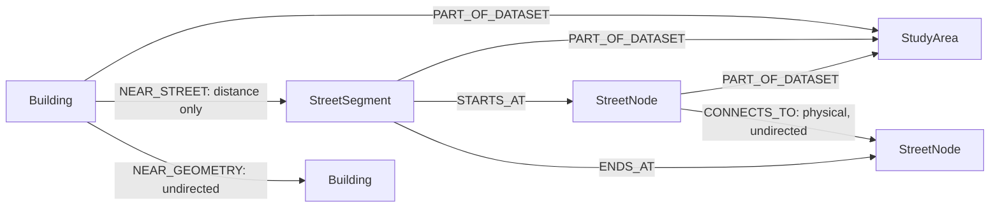

# 图模式与查询（v1）

每个节点额外带 `UrbanEntity` 标签和唯一 `uid`，以研究区分区。原始来源 ID 放在 `source_id`。



| 类型 | 语义 |
|---|---|
| PART_OF_DATASET | 分析数据集归属；不声称完整几何包含，边界外端点也可属于该数据集 |
| STARTS_AT / ENDS_AT | 街段拓扑端点，存储方向仅为确定性表达 |
| CONNECTS_TO | 同一物理街段的网络投影，按无向关系使用；不承诺合法通行 |
| NEAR_STREET | 建筑面与最近街段的几何邻近，access_verified=false |
| NEAR_GEOMETRY | 给定阈值内的建筑面邻近，不等于共享入口、产权或功能依赖 |

保留 StreetSegment 节点使建筑能关联具体街段；CONNECTS_TO 则提供直接的节点间网络。
两者用 segment_id 对应，不应在道路长度汇总时重复累加。
本模式没有房间、产权、使用控制或已核验的真实出入口节点。新清洗数据保留 OSM 已标注的入口、围栏与城市要素 GIS 层，
并在街道节点保留 barrier/entrance/access 等原始标记；这些标记尚未形成经核验的建筑通行关系。

节点包含几何的 WKT、米制 CRS、WGS84 中心点。导入时生成 Neo4j `location` 点属性。
WKT 保留几何便于溯源，并不会使 Neo4j 自动具有完整多边形分析能力。

## Neo4j Browser 示例

先设置参数：

```cypher
:param area_id => 'synthetic_demo'
```

计数：

```cypher
MATCH (n:UrbanEntity {study_area_id: $area_id})
RETURN labels(n) AS labels, count(*) AS count;
```

建筑与最近街段：

```cypher
MATCH (b:Building {study_area_id: $area_id})-[r:NEAR_STREET]->(s:StreetSegment)
RETURN b.source_id, s.source_id, r.distance_m
ORDER BY r.distance_m DESC;
```

查看物理路网（使用无向匹配）：

```cypher
MATCH (a:StreetNode {study_area_id: $area_id})-[r:CONNECTS_TO]-(b:StreetNode)
RETURN a, r, b LIMIT 100;
```

缺少阈值内最近街段的建筑：

```cypher
MATCH (b:Building {study_area_id: $area_id})
WHERE NOT (b)-[:NEAR_STREET]->(:StreetSegment)
RETURN b.source_id, b.location;
```

这只能表达“数据与阈值下没匹配到”，不能据此判断实际不可达。

## 更新语义

导入以 uid 为键，先节点后关系，使用参数化批量 MERGE；关系类型和节点标签来自固定允许列表。
`--dry-run` 在连接数据库之前检查图文件和所有端点。
默认 upsert 不删除旧数据；刷新快照可显式用 `--replace-study-area`。
批次不是整图原子事务；对长期版本管理，应采用新的 study_area_id 或另行实现明确的版本层。

## 清洗数据集的额外约束

设置 `metadata.require_topology_validation=true` 的审计图，在导入前会核对节点
几何类型与 CRS、每条街段唯一首尾节点、线几何与首尾位置、CONNECTS_TO 的对应关系和长度，
以及建筑到道路的几何距离。若检查失败，尚未连接数据库时即拒绝导入。

在保留背景路网的数据集中，按节点 `within_area`、街段 `intersects_core` 分开统计。
`PART_OF_DATASET` 表示进入该数据集，不能解释为对象位于核心区内。
建筑保留 `osm_height_m`、`gba_height_m`、`height_source`、`gba_match_id`、`gba_match_iou`、
`overlap_review`、`height_conflict`、`height_for_analysis_m`、`footprint_requires_review`；没有高度的节点不产生空属性或虚构数值。

查看核心区外围节点与质量标记：

```cypher
:param area_id => 'synthetic_demo'
MATCH (n:StreetNode {study_area_id:$area_id})
RETURN n.within_area AS in_core, count(*) AS count;
```

```cypher
MATCH (b:Building {study_area_id:$area_id})
WHERE b.overlap_review = true OR b.height_conflict = true
RETURN b.source_id, b.overlap_review, b.height_conflict, b.gba_match_iou;
```

## 当前苏州模型

当前窗口为模型 X=23000–29000、Y=0–5000，苏州 GIS 层尚未构建并导入该图模式。
已通过 SHP 道路恢复 WGS84，现有导出/导入器的经纬度前提可以满足；
仍需核验道路线表达、清理并验收路网拓扑，再建立建筑到街段的关系。
高德 POI 为 GCJ-02 原始点；坐标转换与空间关联核验前不能写成 WGS84 location 或实际入口。
旧南京图已按研究区备份并清理，服务与全局唯一性约束保留。
